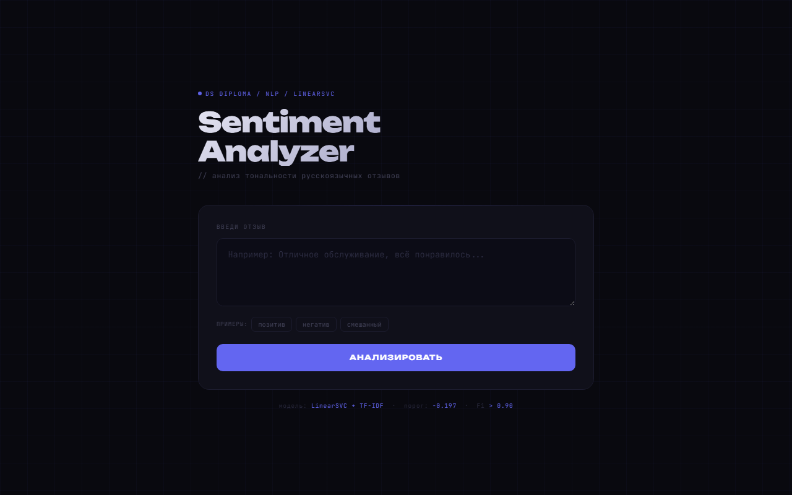

# Yandex Maps Review Sentiment

Binary sentiment classification of Russian-language reviews from Yandex Maps (2023, open dataset
on Hugging Face), from raw text to a deployed API.

- EDA on ratings, business categories and cities, with interactive charts published on
  [GitHub Pages](https://tihonizy.github.io/skillfactory-ds/).
- Text preprocessing: Cyrillic-only cleaning, stop words, lemmatization with pymorphy3.
- TF-IDF with 1-3 word n-grams and 50,000 features. Six models compared: logistic regression,
  LinearSVC, decision tree, random forest, XGBoost and CatBoost.
- Final model: LinearSVC with a decision threshold tuned on a separate validation split.
  F1 and accuracy above 0.90 on the test split. SHAP and error analysis for interpretation.
- The model is served as a FastAPI service: [Tihonizy/sentiment-api](https://github.com/Tihonizy/sentiment-api),
  [live demo](https://sentiment-api-tnbb.onrender.com).

- Notebook: [01_review_sentiment.ipynb](01_review_sentiment.ipynb)
- Tools: pandas, scikit-learn, XGBoost, CatBoost, SHAP, NLTK, pymorphy3, Plotly

[Описание на русском](README.ru.md)
